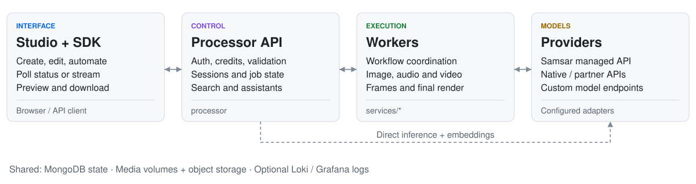
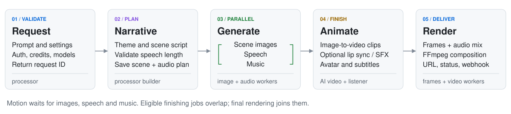
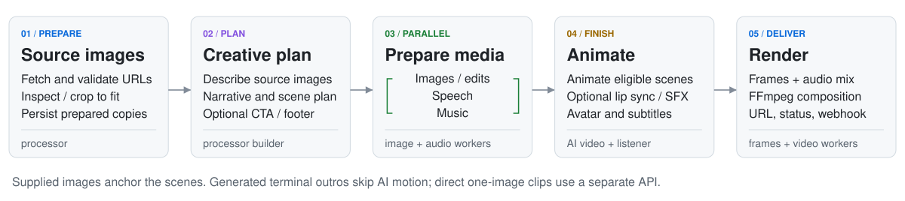
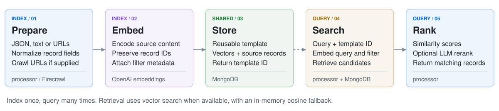
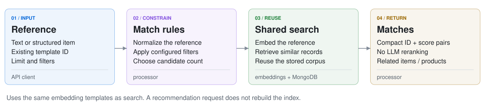

<h1 align="center">
  <a href="https://app.samsar.one">
    
  </a>
</h1>

<p align="center">
  <strong>Turn prompts and images into finished videos. Create, edit, and automate through Studio or the API.</strong>
</p>

<p align="center">
  <a href="https://app.samsar.one">Open Studio</a> ·
  <a href="https://docs.samsar.one">API docs</a> ·
  <a href="https://youtube.com/@samsar_one">Demos</a> ·
  <a href="LICENSE">MIT license</a>
</p>

<p align="center">
  <a href="https://github.com/samsarone/samsar/actions/workflows/ci.yml">
    
  </a>
</p>

<p align="center">
  <a href="#quick-start">Quick start</a> ·
  <a href="#architecture">Architecture</a> ·
  <a href="#visual-workflows">Workflows</a> ·
  <a href="#api">API</a> ·
  <a href="#documentation">Guides</a> ·
  <a href="#deployment-and-operations">Operations</a>
</p>

## Features

- **Generate complete videos:** prompt-to-video and image-list-to-video with narration, music, subtitles, and optional avatars, footers, and CTA outros.
- **Edit after generation:** reroll scenes, retranslate narration, and refine layers in Studio.
- **Create individual assets:** images, edits, video clips, speech, music, lip sync, and sound effects.
- **Build media workflows:** API access, assistants, semantic search, and recommendations over reusable embedding indexes.
- **Run your own stack:** Docker setup wizard, configurable model providers, local or external storage, and optional local logs.

## Quick start

| Goal | Start here |
| --- | --- |
| Create a video now | [Hosted Studio](https://app.samsar.one) |
| Build with the managed API | [Samsar.js example](#api) and a [Samsar API key](https://app.samsar.one/account/apiKeys) |
| Deploy your own Studio and workers | Follow the Docker setup below |

### 1. Clone

```bash
git clone https://github.com/samsarone/samsar.git
cd samsar
```

Already have a checkout? Run the next command from its root.

### 2. Launch the setup wizard

Linux, macOS, or WSL:

```bash
./setup.sh
```

Windows PowerShell:

```powershell
.\setup.ps1
```

Windows Command Prompt also supports `setup.cmd`.

The launcher checks Docker, installs or updates it where supported, and opens the setup wizard at `http://localhost:8089`. **Node.js, npm, and Yarn are not required on the host.** Add a Samsar key or compatible provider credentials, choose services and storage, then complete the admin setup to deploy.

macOS and Windows require **Docker Desktop 4.84.0 or newer**; native Linux requires Docker Engine 20.10.0+, Compose 2.20.0+, and Buildx. Set `SAMSAR_SETUP_INSTALL_DOCKER=0` to manage Docker yourself. See the [setup guide](pages/setup-wizard.md) for platform behavior and [remote setup over SSH](pages/setup-wizard.md#local-access).

### 3. Open Studio

| Service | Default URL |
| --- | --- |
| Studio | `http://localhost:3000` |
| Processor API | `http://localhost:3002` |
| MinIO console, when enabled | `http://localhost:9001` |
| Grafana logs, when enabled | `http://localhost:4000` |

MinIO and Grafana bind to loopback and use generated credentials in `runtime/secrets/`. The default data services are local MongoDB and MinIO; external storage and public access are optional.

> [!NOTE]
> Studio and processor ports are published on the host. Use firewall rules or localhost-only port bindings when the instance should be reachable only from your machine. See [external access](pages/operations.md#external-access).

<a id="platform"></a>

## Architecture

<a href="pages/architecture.md">
  <picture>
    <source media="(prefers-color-scheme: dark)" srcset="docs/readme-diagrams/architecture-dark.svg">
    
  </picture>
</a>

The **processor** owns authentication, sessions, billing, and job state. **Workers** coordinate generation and render media through configured adapters. MongoDB stores durable work and status; media lives in mounted volumes and the configured object store. Browsers retrieve local output through the processor or reverse proxy.

[Request flow](pages/architecture.md#request-flow) · [Services and profiles](pages/architecture.md#compose-profiles) · [Storage and media](pages/architecture.md#storage-and-media) · [Provider routing](pages/providers-and-models.md#fallback-rules)

<details>
<summary><strong>Explore the repository by responsibility</strong></summary>

| Responsibility | Location |
| --- | --- |
| Studio and VidGenie | [apps/samsar-client](apps/samsar-client) |
| Setup wizard | [apps/setup-wizard](apps/setup-wizard) |
| API, auth, billing, sessions, search | [services/processor](services/processor) |
| Video workflow coordination | [services/express-video-listener](services/express-video-listener) |
| Image, audio, AI video generation | [generator](services/generator), [audio-generator](services/audio-generator), [ai-video-layer-generator](services/ai-video-layer-generator) |
| Frame composition and final render | [frames-processor](services/frames-processor), [video-generator](services/video-generator) |
| Assistants and background tasks | [assistant-query-processor](services/assistant-query-processor), [task-processor](services/task-processor) |
| Optional GMICloud gateway | [services/genblaze-gateway](services/genblaze-gateway) |
| Compose and runtime tooling | [deploy/compose](deploy/compose), [scripts](scripts) |
| Generated local config and secrets | `runtime/config`, `runtime/secrets` (gitignored) |

</details>

## Visual workflows

Expand a workflow for its overview. Select a diagram for the complete guide, or use the links below it to jump to a stage. The rows summarize dependencies; parallel work is called out explicitly.

<details open>
<summary><strong>Text to video — prompt to narrated, rendered scenes</strong></summary>

<a href="pages/text-to-video.md#docker-pipeline">
  <picture>
    <source media="(prefers-color-scheme: dark)" srcset="docs/readme-diagrams/text-to-video-dark.svg">
    
  </picture>
</a>

[Request and plan](pages/text-to-video.md#request-and-plan) · [Parallel media](pages/text-to-video.md#parallel-media) · [Motion and finishing](pages/text-to-video.md#motion-and-finishing) · [Render and delivery](pages/text-to-video.md#render-and-delivery)

</details>

<details>
<summary><strong>Image list to video — source images to a product or story video</strong></summary>

<a href="pages/image-list-to-video.md#docker-pipeline">
  <picture>
    <source media="(prefers-color-scheme: dark)" srcset="docs/readme-diagrams/image-list-to-video-dark.svg">
    
  </picture>
</a>

[Sources and plan](pages/image-list-to-video.md#sources-and-plan) · [Parallel media](pages/image-list-to-video.md#parallel-media) · [Motion and finishing](pages/image-list-to-video.md#motion-and-finishing) · [Render and delivery](pages/image-list-to-video.md#render-and-delivery)

</details>

<details>
<summary><strong>Search — index once, query a reusable corpus</strong></summary>

<a href="pages/search.md">
  <picture>
    <source media="(prefers-color-scheme: dark)" srcset="docs/readme-diagrams/search-dark.svg">
    
  </picture>
</a>

[Create an index](pages/search.md#create-an-index) · [Query](pages/search.md#query-search) · [Manage templates](pages/search.md#manage-templates) · [Retrieval fallbacks](pages/search.md#operational-notes)

</details>

<details>
<summary><strong>Recommendations — find related items using the same index</strong></summary>

<a href="pages/recommendations.md">
  <picture>
    <source media="(prefers-color-scheme: dark)" srcset="docs/readme-diagrams/recommendations-dark.svg">
    
  </picture>
</a>

[Inputs](pages/recommendations.md#required-input) · [Filters](pages/recommendations.md#optional-input) · [Usage](pages/recommendations.md#typical-flow) · [Differences from search](pages/recommendations.md#how-it-differs-from-search)

</details>

## API

Install [samsar-js](https://www.npmjs.com/package/samsar-js) and keep your API key in the server environment:

```bash
npm install samsar-js
```

```js
import SamsarClient from 'samsar-js';

const samsar = new SamsarClient({ apiKey: process.env.SAMSAR_API_KEY });
const available = await samsar.getSupportedTextToVideoModels();
console.log(available.data); // Check models enabled for this deployment.

const job = await samsar.createVideoFromText({
  prompt: 'A cinematic product launch in a sunlit gallery.',
  image_model: 'GPTIMAGE2.6',
  video_model: 'RUNWAYML',
  duration: 30,
  aspect_ratio: '16:9',
});
console.log(job.data.request_id); // Save this ID to poll status.
```

Follow the [status and delivery contract](https://docs.samsar.one/video#get-status) for completion and output URLs. The Studio one-shot flow supports up to 3 minutes; the text-to-video API accepts 10–240 seconds.

For a standalone processor, set `baseUrl: 'http://localhost:3002/v1'` and use a credential accepted by that instance. Hosted requests consume Samsar credits. Pricing and retry behavior are documented separately for [images](pages/image-billing.md), [video model calls](pages/video-model-billing.md), and [assistants](pages/assistant-billing.md).

<a id="adapters-models-and-storage"></a>

## Models, adapters, and storage

Choose models from the [model matrix](pages/model-matrix.md), then configure compatible [providers and credentials](pages/providers-and-models.md). The registry covers inference, vision, images, video, speech, music, lip sync, sound effects, embeddings, and transcription. Availability depends on the deployment and workflow; Studio and Express do not expose identical model lists.

Use the Samsar managed adapter, native providers, partner adapters, or registered custom endpoints. Standalone administrators can set compatible adapter order in **Settings → Model Adapters**. Accepted asynchronous jobs stay with their submitting provider while polling.

Media storage supports **local MinIO**, **external S3-compatible storage / CloudFront**, and **Backblaze B2**. See [storage setup](pages/operations.md#storage-options) and [remote-provider access to local media](pages/operations.md#local-media).

## Documentation

| Task | Guide |
| --- | --- |
| Install or configure a deployment | [Setup wizard](pages/setup-wizard.md) · [Operations](pages/operations.md) · [Architecture](pages/architecture.md) |
| Compare models and routes | [Model matrix](pages/model-matrix.md) · [Provider routing](pages/providers-and-models.md) |
| Generate or edit media | [Text to video](pages/text-to-video.md) · [Image list to video](pages/image-list-to-video.md) · [Image edits](pages/image-edit.md) · [Audio and performance](pages/audio-and-performance.md) |
| Build assistants | [Context and local knowledge](pages/assistant-knowledge.md) · [Billing and retries](pages/assistant-billing.md) |
| Search, recommend, or enhance text | [Search](pages/search.md) · [Recommendations](pages/recommendations.md) · [Text enhance](pages/text-enhance.md) |
| Integrate with the hosted API | [API reference](https://docs.samsar.one) · [Narrative and branching](https://docs.samsar.one/narrative) · [External users](https://docs.samsar.one/external-users) · [Publications](https://docs.samsar.one/publications) |
| Understand charges and recovery | [Pricing](https://docs.samsar.one/pricing) · [Images](pages/image-billing.md) · [Video models](pages/video-model-billing.md) · [Assistants](pages/assistant-billing.md) |

## Deployment and operations

Use the wizard for initial setup. The host-side commands below require Node.js and npm:

| Command | Purpose |
| --- | --- |
| `npm run docker:up` | Open the wizard, then deploy the saved configuration if present. |
| `npm run docker:update` | Rebuild and replace changed services. |
| `npm run docker:restart` | Rebuild the configured stack; preserve data volumes. |
| `npm run docker:down` | Stop the stack without deleting data volumes. |
| `npm run docker:maintenance` | Rebuild with job consumers disabled; maintenance persists until explicitly disabled. |
| `npm run docker:check` / `npm run docker:watch` | Inspect Docker health from the host without restarting it. |

[Manual configuration and logs](pages/operations.md) · [Maintenance and recovery limits](docs/docker-runtime-recovery.md) · [Domains and HTTPS](pages/setup-wizard.md#domain-and-reverse-proxy)

<a id="local-media"></a>
<a id="troubleshooting"></a>

For media fetch failures, inspect the [local media tunnel](pages/operations.md#local-media). For stale browser builds, downloads, or remote Grafana access, see [troubleshooting](pages/operations.md#troubleshooting).

## Development

This repository packages sibling source projects into `apps/` and `services/`. In a parent workspace, edit the original service project and [sync it into the monorepo](pages/operations.md#source-workspace-sync). Use `develop` for integration and merge validated changes into `main` through a pull request.

```bash
npm test
npm run test:deployment
```

CI runs these checks for pushes and pull requests to `develop` and `main`. Deployment validation renders local runtime files and requires Docker. Keep credentials, uploads, dependencies, and build output out of commits.

Diagram sources live in [scripts/render-readme-pipeline-diagrams.py](scripts/render-readme-pipeline-diagrams.py). Regenerate the light and dark SVGs with `python3 scripts/render-readme-pipeline-diagrams.py` (no third-party dependencies).

[Blog](https://www.samsar.one/blog/) · [Enterprise deployments](mailto:hello@samsar.one)
